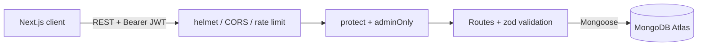

# Doctor Tracker API

REST API for **Doctor Tracker**, a secure admin portal for managing doctors and their patients. Built with Node.js, Express and MongoDB. It handles JWT authentication, validated CRUD for doctors and patients, indexed search/filter/pagination queries, and aggregated dashboard analytics.

- **Frontend repo:** https://github.com/afjalhossain31/Doctor-Tracker-web
- **Backend repo:** https://github.com/afjalhossain31/Doctor-Tracker-api
- **Live API:** `<paste Render URL>` (health check: `/api/health`)
- **Live frontend:** `<paste Vercel URL>`
- **Demo login:** `admin@doctortracker.com` / `Admin@123`

## Tech stack

Node.js 18+, Express 4, MongoDB (Mongoose), JWT, bcryptjs, zod, helmet, cors, express-rate-limit, morgan. JavaScript (ES Modules).

## Setup Guide

```bash
git clone https://github.com/afjalhossain31/Doctor-Tracker-api.git
cd Doctor-Tracker-api
cp .env.example .env     # Windows: copy .env.example .env
npm install
npm run seed             # optional: 12 doctors, 140 patients, admin user (wipes existing data)
npm run dev              # http://localhost:5000
```

Fill in `.env` (see `.env.example`):

| Variable | Purpose |
| --- | --- |
| `PORT` | Server port (default 5000) |
| `MONGODB_URI` | MongoDB / Atlas connection string, include the db name `doctor_tracker` |
| `JWT_SECRET` | Long random string for signing tokens |
| `JWT_EXPIRES_IN` | Token lifetime, e.g. `7d` |
| `CLIENT_URL` | Allowed frontend origin(s) for CORS, comma separated |
| `ADMIN_EMAIL`, `ADMIN_PASSWORD` | Admin created on first start if no user exists |

Check it works: open `http://localhost:5000/api/health`.

## System Architecture



```
src/
  config/      database connection
  models/      User, Doctor, Patient (with indexes)
  routes/      auth, doctors, patients, dashboard
  middleware/  JWT protect, role check, validation, error handler
  validators/  zod schemas
  utils/       pagination, date range, helpers
  scripts/     seed
```

Request flow: login returns a JWT. Every other `/api/*` request must send `Authorization: Bearer <token>`; `protect` verifies it and `adminOnly` checks the role. Writes are validated with zod, and one central error handler returns consistent JSON errors.

## API

| Method | Route | Description |
| --- | --- | --- |
| POST | `/api/auth/login` | Sign in, returns token |
| GET | `/api/auth/me` | Current user |
| GET | `/api/dashboard` | Totals, patients per doctor, daily timeline, conditions, specializations |
| GET / POST | `/api/doctors` | List (`search, specialization, hospital, from, to, sort, page, limit`) / create |
| GET / PUT / DELETE | `/api/doctors/:id` | Read / update / delete (also deletes the doctor's patients) |
| GET / POST | `/api/doctors/:id/patients` | A doctor's patients / add patient |
| DELETE | `/api/doctors/:id/patients/:patientId` | Remove a patient from a doctor |
| GET | `/api/patients` | List (`search, condition, doctor, gender, from, to, sort, page, limit`) |
| PUT / DELETE | `/api/patients/:id` | Edit / delete patient |

List endpoints return `{ items, pagination: { page, limit, total, pages } }`.

## Technical Decisions

**1. Indexed queries and one-shot aggregations.** Filters and sorts are backed by compound indexes: `{doctor, createdAt}`, `{condition, createdAt}`, `{specialization, createdAt}`, `{hospital, createdAt}` and `{createdAt}`. Lists use `skip/limit`, a parallel `countDocuments`, and `.lean()`. Patient counts for a page of doctors come from a single grouped aggregation instead of N queries. The dashboard runs all its aggregations in parallel with `Promise.all` and fills empty days on the server. Trade-off: search uses an escaped, case-insensitive regex so partial words match; for very large data, move to Atlas Search and cursor pagination.

**2. Stateless JWT with layered validation.** A Bearer JWT keeps the API stateless and works cleanly when the frontend (Vercel) and API (Render) sit on different domains, with no cross-site cookie setup. Passwords are hashed with bcrypt (cost 12). Every write body is validated by zod, search input is regex-escaped, login is rate limited, and CORS is restricted to `CLIENT_URL`. Trade-off: a token in browser storage is readable by injected scripts, so the frontend avoids rendering untrusted HTML.

## Deployment (Render + Atlas)

1. Atlas: create an M0 cluster, add a database user, allow `0.0.0.0/0` in Network Access.
2. Render: New Web Service from this repo. Build `npm install`, start `npm start`.
3. Set env vars: `MONGODB_URI`, `JWT_SECRET`, `NODE_ENV=production`, `CLIENT_URL=<Vercel URL>`.
4. Open `<Render URL>/api/health`. The free plan sleeps when idle, so the first request can take 30 to 60 seconds.

## Visual Evidence

API screenshots (health check, a Postman login and list call, Atlas collections) go in `docs/screenshots/`. UI screenshots for desktop and mobile are in the frontend repo README.


